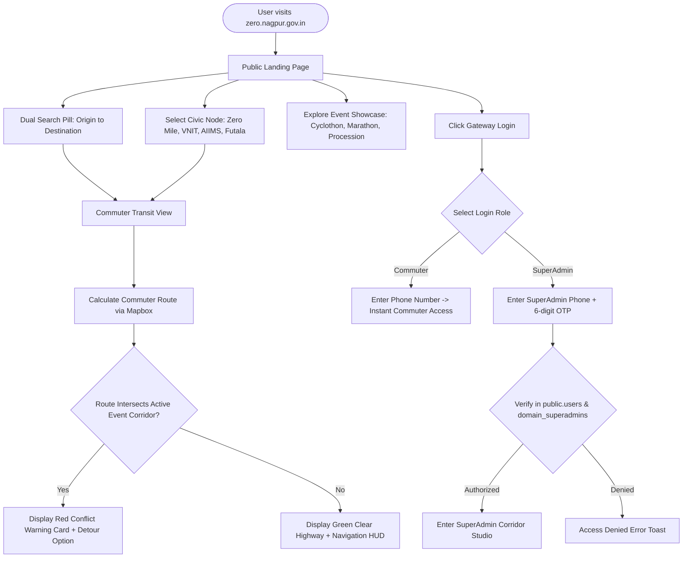
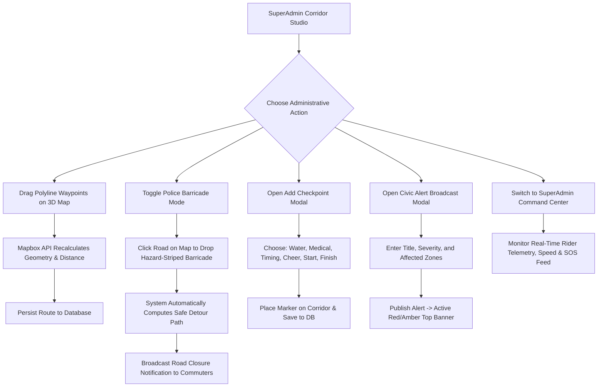
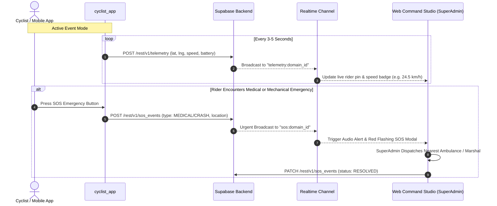
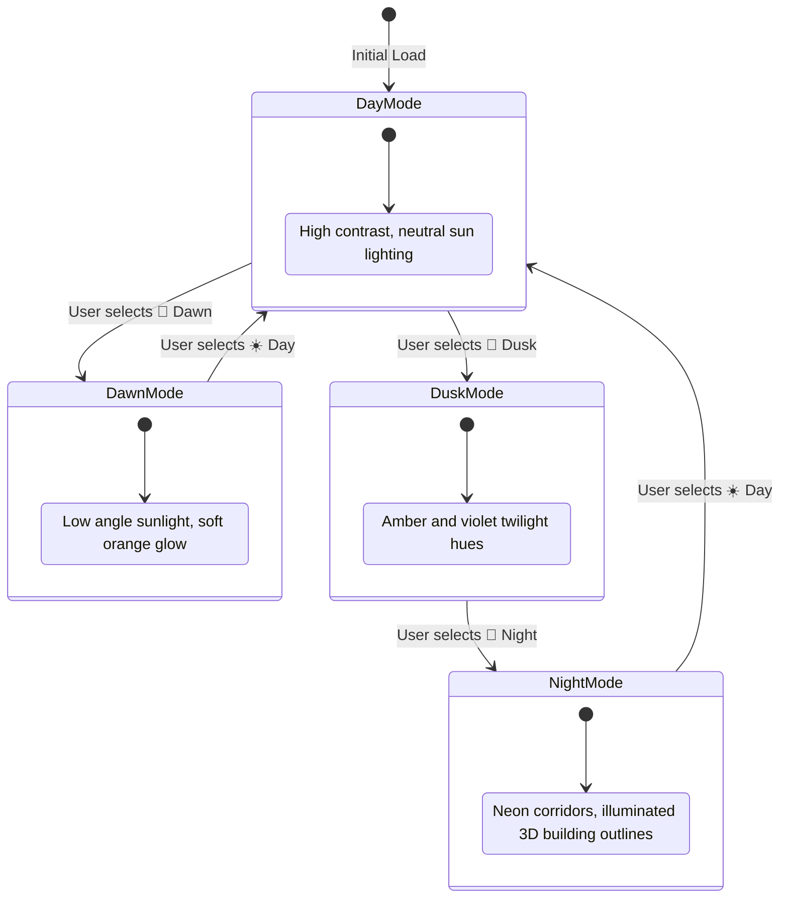

# VIKASIT NAGPUR / ZEROMILE GO — SYSTEM & ROLE FLOW SPECIFICATION

## 1. Primary User Journey & State Transitions

---

## 2. SuperAdmin Operational & Corridor Studio Flow

---

## 3. Real-Time Telemetry & SOS Emergency Escalation Flow

---

## 4. Mapbox 3D Engine & Lighting State Flow

